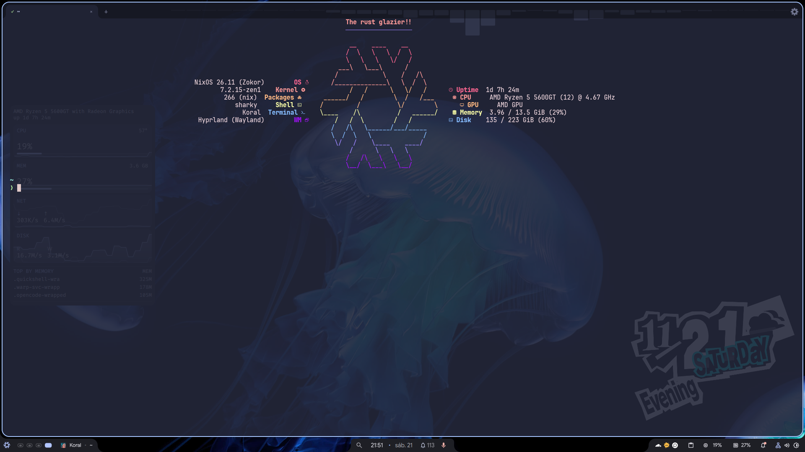
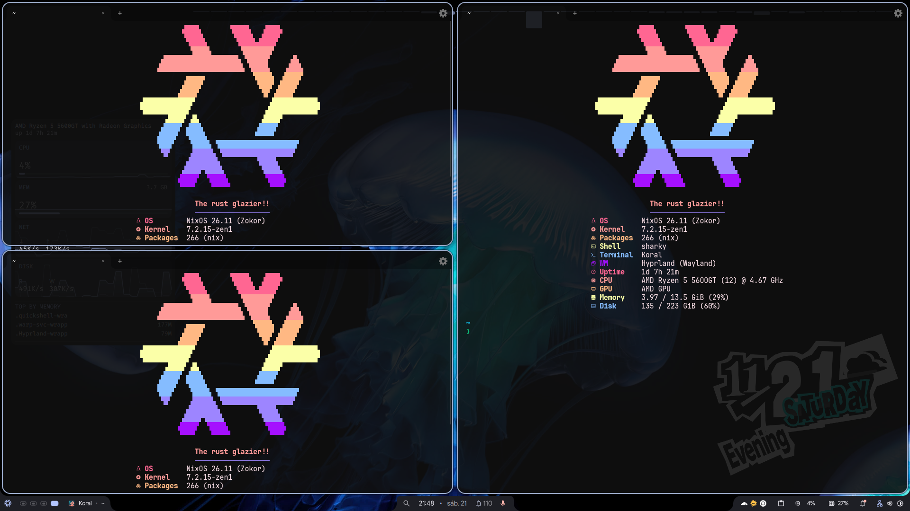
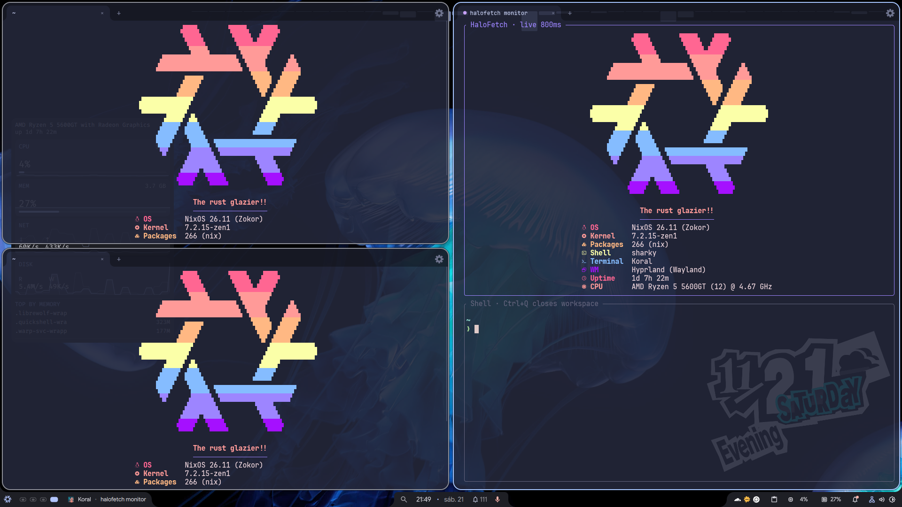
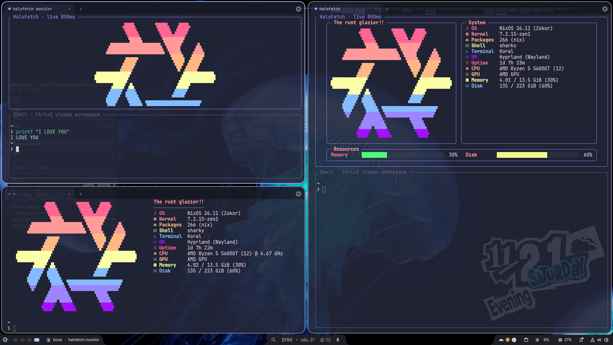

<div align="center">

<h1>halofetch</h1>

<p><strong>A system fetch for the terminal, with configurable panels and a live monitor.</strong></p>

<p>
  halofetch prints your system information next to an ASCII logo or a PNG image.
  It has three layouts, an editor for the configuration, and a monitor that keeps
  the fetch above a real shell.<br>
  It is a single Rust binary and runs on Linux and Windows.
</p>

<p>
  <a href="https://github.com/mafuzyk/halofetch/releases"></a>
  <a href="https://github.com/mafuzyk/halofetch/actions/workflows/ci.yml"></a>
  <a href="https://github.com/mafuzyk/halofetch/actions/workflows/release.yml"></a>
  <a href="LICENSE"></a>
  <a href="Cargo.toml"></a>
</p>



<sub><i>The classic layout, with a colored logo and two panels.</i></sub>

<p>
  <a href="#installation">Installation</a> ·
  <a href="#benchmarks">Benchmarks</a> ·
  <a href="#modes">Modes</a> ·
  <a href="#configuration">Configuration</a> ·
  <a href="#fastfetch-migration">Migration</a> ·
  <a href="#documentation">Docs</a>
</p>

</div>

---

## What it does

- **Three layouts.** `classic` puts the logo between two panels, `side` puts it on the left, and `dashboard` draws boxes with gauges.
- **Fetch or monitor.** `halofetch fetch` prints once and exits. `halofetch monitor` refreshes the scene above `$SHELL -i` in a pseudo-terminal.
- **Reads only enabled fields.** Hidden and disabled fields are skipped by the fetch, the monitor and the JSON output.
- **No made-up values.** Data comes from `/proc`, `/sys`, `/etc` and a few local commands. When a value cannot be read, the field is omitted.
- **Editable without hand-editing JSON.** The terminal editor changes layouts, logos, colors, fields and startup behavior, with a live preview.
- **Safe writes.** The configuration is validated, migrated when needed, and replaced atomically. A symlink at the config path is refused.
- **Scriptable.** `--format json`, separate profiles with `--config`, and `halofetch benchmark` are built in.

<h2 align="center" id="benchmarks">Benchmarks</h2>

Median wall-clock time on the reference machine (`Linux 7.2.15-zen1 x86_64`, NixOS, `fastfetch 2.70.0`), same 13 modules, 30 measured runs after 5 warmups, no halofetch cache, stdout redirected to `/dev/null`:

| Benchmark | halofetch | fastfetch | Comparison |
| --- | ---: | ---: | --- |
| ANSI, median | **58.0 ms** | 147.0 ms | **39.5% of fastfetch** |
| ANSI, p95 | **60 ms** | 151 ms | 2.5× lower tail |
| `sharky -c exec` (shell startup included) | **59 ms** | 145 ms | 41% of fastfetch |

The same harness gives **58.0 ms median** and **64 ms p95** for `--format json`. JSON was not compared against fastfetch.

<details>
<summary>How the benchmark is measured, and why the package count differs</summary>

- Setup: the same 13 fields in both tools, no image, no halofetch cache, 5 warmups and 30 measured runs per command. The harness is a shell script kept outside the repository.
- The package counts are not directly comparable. halofetch reports **265 Nix packages** across the system and user profiles by reading manifests and direct profile references, then deduplicating store paths.
- fastfetch reports the `nix-system` and `nix-user` profile closures. That includes dependencies and produces a much larger number. We ran both anyway, and halofetch still took 39.5% of fastfetch's time.
- The fetch only collects enabled fields. A configuration with more fields does more work.

</details>

<h2 align="center" id="screenshots">Screenshots</h2>

| Multiple terminals | Live monitor |
| --- | --- |
|  |  |

| Dashboard and monitor | Classic at full width |
| --- | --- |
|  |  |

<h2 align="center" id="installation">Installation</h2>

### Nix and NixOS

```bash
nix run github:mafuzyk/halofetch
nix profile install github:mafuzyk/halofetch
```

The flake exposes the package and can be added to a NixOS or Home Manager configuration. Nix installs are managed by Nix, so `halofetch update` refuses to replace the binary.

<details>
<summary>NixOS module, Home Manager module and development shell</summary>

The NixOS module installs the package without touching any user's shell configuration:

```nix
{
  inputs = {
    nixpkgs.url = "github:NixOS/nixpkgs/nixos-unstable";
    halofetch.url = "github:mafuzyk/halofetch";
  };

  outputs = { nixpkgs, halofetch, ... }: {
    nixosConfigurations.host = nixpkgs.lib.nixosSystem {
      system = "x86_64-linux";
      modules = [
        halofetch.nixosModules.default
        { programs.halofetch.enable = true; }
      ];
    };
  };
}
```

The Home Manager module installs the package and leaves the configuration file and shell hooks alone:

```nix
{
  imports = [ halofetch.homeManagerModules.default ];
  programs.halofetch.enable = true;
}
```

Both modules also accept `programs.halofetch.package` to build from another source. Use `halofetch init fish` (or bash, zsh, sharky) for an interactive startup hook, and `halofetch config` for the configuration file.

For local work:

```bash
nix develop
nix build .#halofetch
nix run .#halofetch -- fetch
```

The package puts `LICENSE`, `THIRD_PARTY_NOTICES.md`, `README.md`, `DOCS.md` and `logos/README.md` under `share`, so the installed copy carries the same notices as the release archives.

</details>

### Prebuilt binary

Each release publishes a static musl build (`x86_64-unknown-linux-musl`), a glibc build (`x86_64-unknown-linux-gnu`) and a Windows archive, each with a SHA-256 file:

```bash
version=v3.3.0
archive=halofetch-$version-x86_64-unknown-linux-musl.tar.gz
curl -fLO "https://github.com/mafuzyk/halofetch/releases/download/$version/$archive"
curl -fLO "https://github.com/mafuzyk/halofetch/releases/download/$version/$archive.sha256"
sha256sum -c "$archive.sha256"
tar -xzf "$archive"
install -Dm755 halofetch ~/.local/bin/halofetch
```

The archive also contains `LICENSE`, `README.md` and `THIRD_PARTY_NOTICES.md`. Make sure `~/.local/bin` is in `PATH`. For Windows, see [Windows](#windows).

### Build from source

```bash
git clone https://github.com/mafuzyk/halofetch.git
cd halofetch
cargo build --release --locked
install -Dm755 target/release/halofetch ~/.local/bin/halofetch
```

Rust and Cargo are needed only to build. The release profile is tuned in `Cargo.toml`.

### Start with your shell

Install the startup hook with:

```bash
halofetch init fish     # fish
halofetch init bash     # bash
halofetch init zsh      # zsh
halofetch init sharky   # sharky
```

The hook only runs in interactive shells, checks that `halofetch` is installed, and runs `halofetch fetch`. It never starts the monitor inside its own embedded shell. Remove it with:

```bash
halofetch init fish --remove
```

<h2 align="center" id="modes">Modes</h2>

### Fetch

```bash
halofetch fetch
halofetch fetch --scene side
halofetch fetch --watch
```

`fetch` renders once and exits. `--watch` redraws the scene in place until `q`, `Esc` or `Ctrl+C`, and `-i` sets the interval from 100 to 60000 ms.

| Scene | Also accepted as | Shape |
| --- | --- | --- |
| `classic` | | Logo centered between two information panels |
| `side` | `classicfetch`, `fastfetch` | Logo on the left, information on the right |
| `dashboard` | `cockpit` | Framed logo and System box, then Resources with gauges |

When space runs out, the scenes stack instead of cutting values. `classic` stacks the logo, title and rows when a panel would need fewer than 10 value columns. `side` puts the logo above the information when the logo and 30 information columns do not fit. `dashboard` stacks its boxes and uses two inner columns when the terminal is wide enough.

### Monitor

```bash
halofetch monitor
halofetch monitor -i 500
```

The upper region shows the scene with live values. The lower region is `$SHELL -i` in a pseudo-terminal, drawn through a VT100 parser, so completion, history, SSH, editors and control keys work normally. `Ctrl+Q` closes the workspace. Uptime, load, processes, memory, swap, disk, battery, temperature, backlight, CPU usage and GPU usage refresh in place. Packages, fonts and desktop detection run once.

In an interactive terminal without a configuration file, plain `halofetch` opens the editor. Saving creates `~/.config/halofetch/config.json`. `halofetch fetch` always prints one fetch, and `halofetch monitor` always opens the workspace.

<h2 align="center" id="configuration">Configuration</h2>

### Fields and panels

halofetch has 32 fields in seven groups: System, Software, Desktop, Hardware, Resources, Network and Power. Each panel entry can be shown or hidden, renamed, given another icon, drawn as a bar when the field has a gauge, and moved within or between panels. Labels are limited to 24 characters and icons to 4.

CPU usage and GPU usage are live values and appear only in monitor mode. Narrow CPU values drop the clock before the core count. Narrow GPU values drop `Corporation`, `Inc.` and `Series` before truncation.

### Themes and logos

Choose one of the 27 built-in palettes, enter `#RRGGBB` colors separated by spaces, change the gradient, or save the current palette with `halofetch preset apply NAME`. The default is `amethyst`.

The logo can be detected from the distribution, chosen from 466 embedded logos, read from a file, pasted in the editor, or drawn as a PNG. `logo.compact` forces the small variant even when the full one fits. A file named after a logo in the configuration's `logos/` directory overrides the embedded art.

The embedded ASCII art is derived from fastfetch's MIT-licensed collection. See [`logos/README.md`](logos/README.md) and [`THIRD_PARTY_NOTICES.md`](THIRD_PARTY_NOTICES.md) for exact provenance, the normalization applied and the license notice.

### Image logos

```jsonc
{
  "logo": {
    "source": { "kind": "auto" },
    "compact": false,
    "image": {
      "path": "~/Pictures/logo.png",
      "width": 32,
      "height": 16,
      "protocol": "auto"
    }
  }
}
```

```bash
halofetch --image ~/Pictures/logo.png fetch
```

Images are drawn with the Kitty graphics protocol on terminals that support it, including Koral, kitty, WezTerm and Ghostty. The reserved grid is laid out like an ASCII logo, so `classic`, `side` and `dashboard` position it normally. If the image is missing, invalid or cannot be drawn, the original character logo is rendered instead. `--image` changes the path only and keeps the configured protocol and size. Only the static fetch draws images; `fetch --watch` and `monitor` keep the character logo.

PNG files are validated before they reach the terminal: signature, chunk boundaries, CRC, IHDR dimensions and color type, IDAT presence and IEND. A file is limited to 16 MiB and 16384 pixels per side.

<h3 id="fastfetch-migration">Fastfetch migration</h3>

```bash
halofetch config import-fastfetch
halofetch config import-fastfetch ~/.config/fastfetch/config.jsonc --dry-run
```

The importer reads JSONC with comments and trailing commas, maps the logo, padding, colors, title and modules, splits modules into the two panels, and reports what it skipped instead of dropping it silently. Inline `logo.type: "data"` art is saved as `logos/fastfetch-logo.txt`; an existing file and configuration are backed up with numbered `.bak` names. `logo.type: "small"` sets `logo.compact`. Only Kitty images are imported because halofetch renders Kitty graphics; sixel, iTerm, chafa and raw logos produce a warning.

### Config files

The default path is `~/.config/halofetch/config.json`, and `halofetch config path` prints the active path. The file is checked before saving and written through an exclusive temporary file with `fsync` and an atomic rename. Existing permissions are preserved, a new file is private (`0600`), and a symlink at the destination is refused. Out-of-range values are clamped on load, and an unusable file is moved aside as `.invalid` instead of deleted.

Use another profile without touching the daily setup:

```bash
halofetch -c ./screenshots.json config
halofetch -c ./screenshots.json fetch
```

<details>
<summary>Editor sections and keys</summary>

1. **Appearance**: theme, palette, gradient, info style, title colors and palette saving.
2. **Logo**: source, compact variants, file path, image path, image size and image protocol.
3. **Fields**: both panels, visibility, order, labels, icons and bars.
4. **Layout**: scene, gap, padding, cascade, maximum value width, empty-field hiding, color blocks and title.
5. **Startup**: fetch or monitor mode and the refresh interval.

| Key | Action |
| --- | --- |
| `↑` `↓` | Move between sections or rows |
| `→` `Enter` `Tab` | Open a section |
| `Esc` `Tab` | Return to the section menu |
| `←` `→` | Change a choice or number |
| `Enter` | Edit text, open a list or activate a row |
| `Space` | Toggle a switch, or show/hide a field |
| `Shift` + `↑` `↓` | Move a field within its panel or across the edge |
| `Shift` + `←` `→` | Move a field to the left or right panel |
| `a` or `Insert` | Add a field after the selection |
| `Delete` or `Backspace` | Remove the selected field |
| `Ctrl+Z` | Restore the last removed field |
| `F1` or `?` | Key help |
| `F2` | Full-screen preview |
| `Ctrl+S` | Validate, save and exit |
| `q` | Quit, with a Save/Discard/Cancel prompt when needed |
| `Ctrl+C` | Quit without saving |

The editor needs at least 60 × 18. From 110 columns the menu, settings and preview share a row; narrower terminals put the preview below the settings.

</details>

<details>
<summary>Version 3 configuration shape</summary>

```json
{
  "version": 3,
  "scene": "classic",
  "startup": { "mode": "fetch", "interval_ms": 1000 },
  "logo": {
    "source": { "kind": "auto" },
    "gradient": "horizontal",
    "auto_small": true,
    "compact": false,
    "image": {
      "path": "",
      "width": 32,
      "height": 16,
      "protocol": "auto"
    }
  },
  "colors": {
    "palette": ["#C084FC", "#A78BFA", "#818CF8", "#6366F1", "#4F46E5"],
    "title": "#FF9A98",
    "separator": "#9D85FF",
    "value": "#F5DCE3"
  },
  "title": { "enabled": true, "format": "{user}@{host}", "separator": "─" },
  "layout": {
    "style": "powerline",
    "gap": 3,
    "padding": 2,
    "cascade": 0,
    "max_value_width": 0,
    "hide_empty": true,
    "icons": "nerd",
    "color_blocks": true
  },
  "fields": {
    "left": [
      { "field": "os", "label": "OS", "icon": "", "enabled": true, "bar": false },
      { "field": "kernel", "label": "Kernel", "icon": "", "enabled": true, "bar": false }
    ],
    "right": []
  },
  "custom_palettes": {}
}
```

`logo.image.protocol` accepts `auto`, `kitty` and `none`. `auto` detects the terminal through `TERM_PROGRAM`, `TERM`, `KITTY_WINDOW_ID` and `WEZTERM_PANE`; `kitty` forces the protocol when stdout is a terminal; `none` disables image drawing. Only Kitty graphics is implemented.

</details>

<h2 align="center" id="commands">Commands</h2>

| Command | What it does |
| --- | --- |
| `halofetch` | Editor on first run, then the configured startup mode, otherwise one static fetch |
| `halofetch fetch` | Print one static fetch |
| `halofetch fetch --watch` | Redraw until `q`, `Esc` or `Ctrl+C`; `-i` sets the interval |
| `halofetch fetch --scene side` | Print one fetch with a chosen scene |
| `halofetch monitor` | Scene plus embedded shell |
| `halofetch --format json` | Detected fields as versioned JSON |
| `halofetch --image PATH fetch` | Use a PNG in place of the logo for one static fetch |
| `halofetch config` | Open the editor |
| `halofetch config path` | Print the active configuration path |
| `halofetch config reset` | Back up the configuration and open the editor with defaults |
| `halofetch config import-fastfetch [FILE] [--dry-run]` | Convert a fastfetch JSONC configuration |
| `halofetch init SHELL [--remove]` | Install or remove an interactive startup hook |
| `halofetch preset list` | List built-in and custom palettes |
| `halofetch preset apply dracula` | Apply a palette and save |
| `halofetch logos list` | List embedded and user logos |
| `halofetch logos show [KEY]` | Print one colored logo |
| `halofetch benchmark` | Measure collection and rendering (`-n` runs) |
| `halofetch update [--release]` | Update from a checkout or the latest release |

`--scene`, `--format`, `--image` and `-c/--config PATH` work before or after the command. Run `halofetch --help` for every flag.

Colors go to a terminal only. A pipe or file gets plain text, as do `TERM=dumb` and a non-empty `NO_COLOR`. A non-empty `FORCE_COLOR` keeps colors in a pipe:

```bash
FORCE_COLOR=1 halofetch | less -R
```

<h2 align="center" id="json-output">JSON output</h2>

```bash
halofetch --format json | jq '.system.cpu'
```

The document has `schema_version` 2, `system` and `gauges`. `system` contains the enabled fields in declaration order, plus `user` and `host` when the title is enabled. Disabled or unreadable fields are absent. `gauges` holds numbers: `memory`, `swap`, `disk` and `vram` as `used`/`total` bytes with `percent`, plus `cpu_percent`, `gpu_percent`, `cpu_temp_celsius`, `battery_percent` and `brightness_percent`. Check that a key exists before reading it.

<h2 align="center" id="windows">Windows</h2>

Windows 10 and 11 are supported through `%APPDATA%\halofetch\config.json`, PowerShell or cmd as the embedded shell, and the same editor, scenes and JSON output. Extract `halofetch.exe` from the release zip and put it on `PATH`. The archive also contains `LICENSE`, `README.md` and `THIRD_PARTY_NOTICES.md`.

Windows Terminal does not render Kitty images, so `logo.image` falls back to the character logo. GPU names, VRAM, memory, disk, battery, brightness, resolution, network and process values are read through Win32 where available. File replacement follows the platform rules; the Unix symlink refusal applies only where symlinks are supported.

<h2 align="center" id="documentation">Documentation</h2>

- [`DOCS.md`](DOCS.md): architecture, field catalog, configuration, migration, rendering and testing
- [`logos/README.md`](logos/README.md): logo provenance and normalization
- [`THIRD_PARTY_NOTICES.md`](THIRD_PARTY_NOTICES.md): fastfetch MIT notice
- [`LICENSE`](LICENSE): GPL-3.0-or-later

<h2 align="center" id="development">Development</h2>

```bash
cargo fmt --all -- --check
cargo clippy --all-targets -- -D warnings
cargo test --all
cargo build --release --locked
```

The static fetch, editor preview and monitor share `src/render`. Detection lives in `src/info`, configuration and validation in `src/config`, image encoding in `src/image`, fastfetch migration in `src/fastfetch`, and startup hooks in `src/init`. CI runs formatting, clippy, tests and release builds on Linux and Windows, plus the Nix flake.

<h2 align="center" id="license">License</h2>

halofetch is licensed under [GPL-3.0-or-later](LICENSE). The embedded ASCII logos are derived from fastfetch's MIT-licensed collection; see [THIRD_PARTY_NOTICES.md](THIRD_PARTY_NOTICES.md) for the required notice.

Issues and patches are welcome. Include your terminal, shell and scene when reporting a layout bug.
